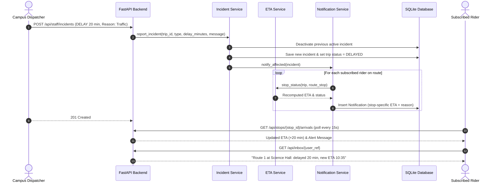

# Campus Transport Experience — "Where's My Bus?"

A real-time campus transit disruption management and rider notification platform built with Python 3.11+, FastAPI, SQLAlchemy 2.x, SQLite, Pydantic v2, and a vanilla HTML/JS frontend with zero build steps.

---

## 1. Problem Chosen and Why

### The Friction
During transit disruptions—traffic delays, vehicle breakdowns, or route cancellations—riders are left in the dark and flood campus dispatch staff with repeated inquiries: *"Where's my bus?"*
- Dispatchers are overwhelmed answering phone calls instead of resolving road disruptions.
- Riders experience uncertainty, frustration, and missed classes or commitments.

### The Solution
- **Staff log an incident once** from a dispatch console (specifying delay minutes, breakdown, or cancellation).
- **The system recomputes ETAs and trip status** across all downstream stops automatically.
- **Subscribed riders are immediately notified** with stop-specific contextual messages and updated arrival times.
- **Result:** Transparency, trust, proactive communication, and dramatically fewer calls to dispatch staff.

---

## 2. How It Works

### Architecture & Incident Lifecycle



### State Transitions & Staleness Detection
- **`SCHEDULED`**: Normal regular schedule. Stop status is `ON_TIME`.
- **`DELAYED`**: Active delay minutes added to scheduled departure offset (`estimated_time = scheduled_time + delay_minutes`).
- **`BROKEN_DOWN` / `CANCELLED`**: `estimated_time` is `None` to prevent misleading riders, displaying the incident reason prominently.
- **Superseding**: Logging a new incident automatically deactivates the prior incident, ensuring strictly one active incident per trip while preserving full audit history.
- **`RESOLVED`**: Restores trip status to `SCHEDULED`, deactivates disruption, and broadcasts a *"back on schedule"* notification.
- **Stale Detection (`is_stale`)**: If an active incident was created $> 10$ minutes ago without staff updates, a visible stale warning banner alerts riders that conditions may have changed.

---

## 3. Setup and Run

### Prerequisites
- Python 3.11+
- Git

### 1. Create and Activate Virtual Environment
```bash
# Clone repository
git clone <repo_url>
cd digii

# Create virtualenv
python -m venv .venv

# Activate on Windows (PowerShell):
.venv\Scripts\Activate.ps1
# Or on Windows (cmd):
# .venv\Scripts\activate.bat
# Or on macOS/Linux:
# source .venv/bin/activate
```

### 2. Install Dependencies
```bash
pip install -r requirements.txt
```

### 3. Seed Database (Idempotent)
Populates 2 routes, 6 stops, 48 hourly trips for the next 24 hours, and 3 demo subscriptions:
```bash
python seed.py
```

### 4. Run the Application
```bash
uvicorn app.main:app --reload
```
The application will be running at:
- **Rider Interface**: [http://localhost:8000/](http://localhost:8000/)
- **Staff Portal**: [http://localhost:8000/staff](http://localhost:8000/staff)
- **Interactive OpenAPI Docs**: [http://localhost:8000/docs](http://localhost:8000/docs)

### 5. Environment Variables
- `STAFF_KEY`: Secret key for staff dispatch endpoints. Default: `"dev-key"`.
- `DATABASE_URL`: Database connection URL. Default: `"sqlite:///./campus_transport.db"`.

### 6. Run Automated Test Suite
```bash
pytest -v
```

---

## 4. Example `curl` Commands

### 1. Check Arrivals for a Campus Stop (Rider)
```bash
curl -X GET http://localhost:8000/api/stops/1/arrivals
```

### 2. Subscribe to Route Alerts (Rider)
```bash
curl -X POST http://localhost:8000/api/subscriptions \
  -H "Content-Type: application/json" \
  -d '{
    "user_ref": "user_alice",
    "route_id": 1,
    "stop_id": 1
  }'
```

### 3. Check Rider Notification Inbox
```bash
curl -X GET http://localhost:8000/api/inbox/user_alice
```

### 4. Report a Transit Delay (Staff Dispatch)
```bash
curl -X POST http://localhost:8000/api/staff/incidents \
  -H "Content-Type: application/json" \
  -H "X-Staff-Key: dev-key" \
  -d '{
    "trip_id": 1,
    "type": "DELAY",
    "delay_minutes": 20,
    "message": "Heavy traffic near university stadium",
    "created_by": "dispatcher_dan"
  }'
```

### 5. Resolve Disruption (Staff Dispatch)
```bash
curl -X POST http://localhost:8000/api/staff/incidents/1/resolve \
  -H "Content-Type: application/json" \
  -H "X-Staff-Key: dev-key" \
  -d '{
    "message": "Bottleneck cleared, shuttle resuming scheduled route.",
    "created_by": "dispatcher_dan"
  }'
```

### 6. View Operational Metrics & Incident Audit Trail
```bash
# Summary numbers (active disruptions, total alerts, calls avoided)
curl -X GET http://localhost:8000/api/staff/summary -H "X-Staff-Key: dev-key"

# Chronological audit history for a trip
curl -X GET http://localhost:8000/api/staff/trips/1/history -H "X-Staff-Key: dev-key"
```

---

## 5. API Reference Table

| Method | Endpoint | Description | Auth Required |
|---|---|---|---|
| `GET` | `/` | Rider view HTML page | None |
| `GET` | `/staff` | Staff portal HTML page | None |
| `GET` | `/health` | Service health check | None |
| `GET` | `/api/routes` | List all transit routes and stop sequences | None |
| `GET` | `/api/stops` | List all campus stops alphabetically | None |
| `GET` | `/api/stops/{stop_id}/arrivals` | Upcoming trip arrivals with computed ETAs & delay info | None |
| `POST` | `/api/subscriptions` | Subscribe rider to route/stop alerts | None |
| `DELETE` | `/api/subscriptions/{id}` | Delete an existing subscription | None |
| `GET` | `/api/inbox/{user_ref}` | Fetch alert notifications for a rider | None |
| `GET` | `/api/staff/trips` | Upcoming trips and active incident states | `X-Staff-Key` |
| `POST` | `/api/staff/incidents` | Log a disruption (`DELAY`, `BREAKDOWN`, `CANCELLATION`) | `X-Staff-Key` |
| `POST` | `/api/staff/incidents/{trip_id}/resolve` | Resolve disruption and restore schedule | `X-Staff-Key` |
| `GET` | `/api/staff/trips/{trip_id}/history` | Audit trail of all incidents logged for trip | `X-Staff-Key` |
| `GET` | `/api/staff/summary` | Summary metrics: active incidents, notifications, calls avoided | `X-Staff-Key` |

---

## 6. Design Decisions and Trade-offs

1. **Domain Services vs Thin Handlers**: All business logic (ETA calculation, incident superseding, staleness evaluation, notification formatting) lives strictly inside `app/services/`. API endpoints only perform validation, dependency injection, and HTTP formatting.
2. **Injectable Clock (`now: datetime | None = None`)**: Every service accepting or calculating time supports an explicit `now` parameter defaulting to UTC. This enables 100% deterministic, flake-free unit and temporal testing.
3. **Vanilla JS & Zero-Build Frontend**: Avoided React/Vue/Node build tooling. The static frontend is served directly by FastAPI, loading instantly in any browser without npm packages or bundling steps.
4. **Resilient Notification Delivery**: Notification generation is wrapped per subscriber in a `try/except` block with individual transaction handling. If an issue occurs notifying one rider, it does not abort notifications for other subscribers.
5. **Single Active Incident Enforcement**: Only one incident can be active per trip at any time. When a new incident is created, all prior active incidents are marked `is_active = False` while maintaining the immutable audit trail.
6. **SQLite + StaticPool**: Standard SQLite file on disk for local execution and `sqlite:///:memory:` with `StaticPool` for rapid, isolated test execution across multiple sessions.

---

## 7. Assumptions

- **Fixed Route Stop Sequences**: Each route has a deterministic sequence of stops with predefined offset minutes from the scheduled trip departure.
- **Route-Wide Disruptions**: Incidents reported on a trip currently impact all downstream stops along that trip's route.
- **In-App Notification Inbox**: Polling the inbox via HTTP endpoints is sufficient for campus rider transparency within the prototype scope.
- **Lightweight Auth Stand-in**: Header token `X-Staff-Key` represents authenticated campus dispatchers without adding complex OAuth2 server infrastructure.

---

## 8. Deliberately NOT Built & Why

1. **Live GPS / Telemetry Hardware**: Hardware tracking devices on campus buses require physical IoT infrastructure and cellular SIM contracts. The core business bottleneck is communicating disruption *intent* and status, which staff can log in seconds.
2. **Machine Learning Arrival Predictions**: ML models require massive historical arrival datasets and feature engineering. For fixed campus loops, schedule offset + reported delay is accurate, explainable, and immediately reliable.
3. **Complex Multi-Tenant Auth / OAuth2**: Integrating full institutional SAML/SSO authentication adds significant boilerplate unrelated to the core transport problem.
4. **Real SMS / Mobile Push Gateways**: Third-party SMS gateways (Twilio, AWS SNS) require external paid API credentials and phone verification. In-app notifications fulfill the product flow cleanly.
5. **Distributed Rate Limiting**: Requires Redis or external memory caches; omitted to keep deployment self-contained with zero external daemon requirements.

---

## 9. What I'd Do Next

1. **Live GTFS-RT & GPS Ingestion**: Integrate GTFS Realtime feeds for automated delay detection when vehicles are equipped with transponders.
2. **Server-Sent Events (SSE) or WebSockets**: Replace 15-second client polling with lightweight event streaming for real-time status pushes.
3. **Institutional SSO (SAML 2.0 / OIDC)**: Connect campus student & staff credentials with Role-Based Access Control (RBAC).
4. **Multichannel Delivery**: Optional SMS / WhatsApp / Campus App push notification adapters for high-priority alerts.
5. **Digest Modes & Rate Limiting**: Consolidate frequent delay updates (e.g. 5m $\rightarrow$ 10m $\rightarrow$ 15m) into rate-limited digests to prevent notification fatigue.
6. **Operational Analytics Dashboard**: Historical charts showing mean time to resolution (MTTR), route disruption hotspots, and metrics on estimated dispatch calls avoided over time.
